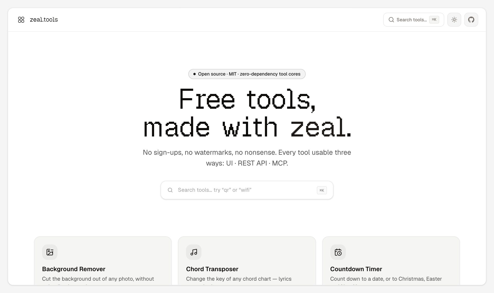
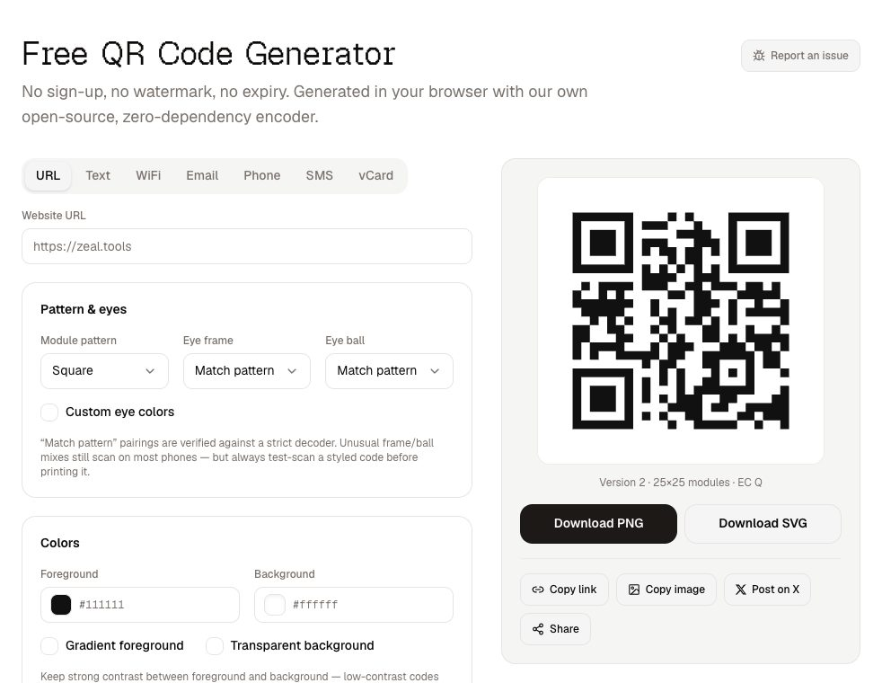
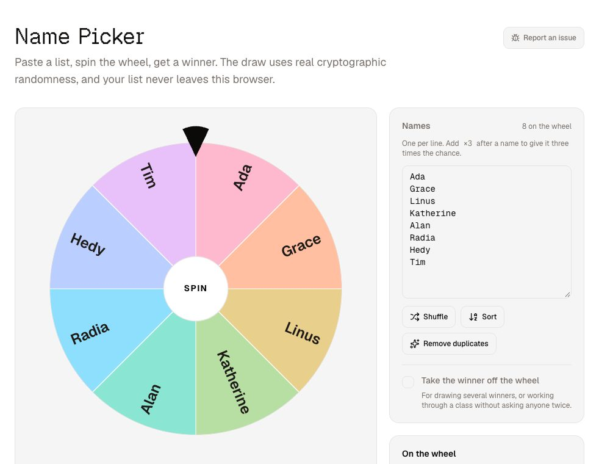
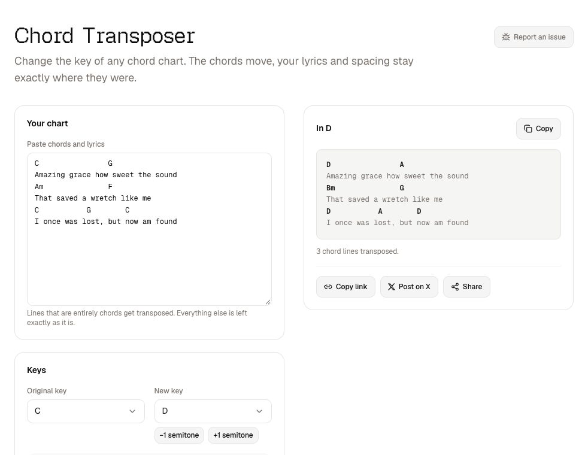
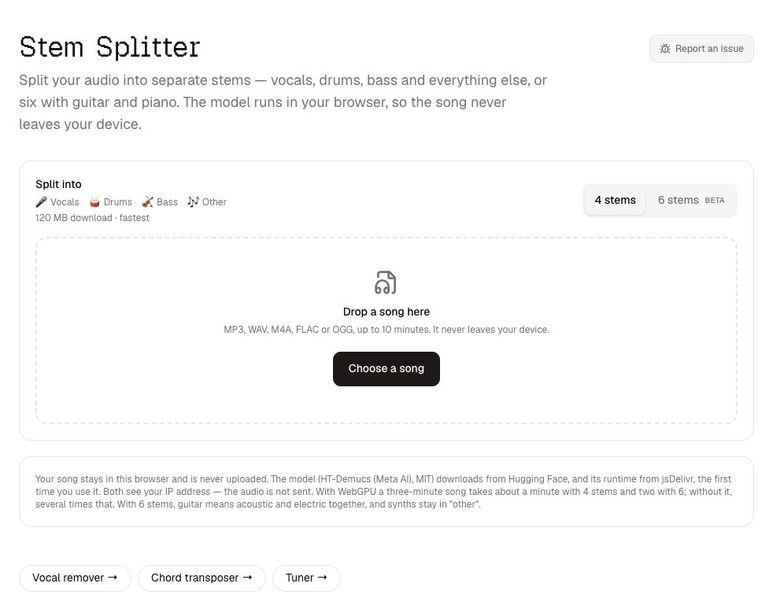
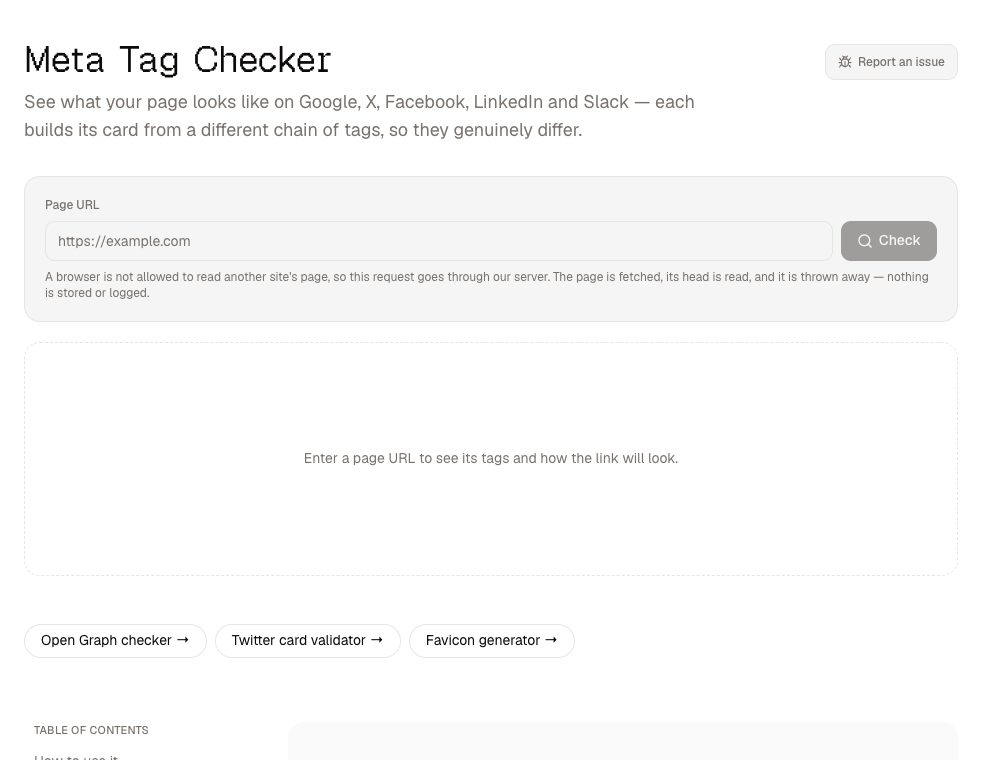
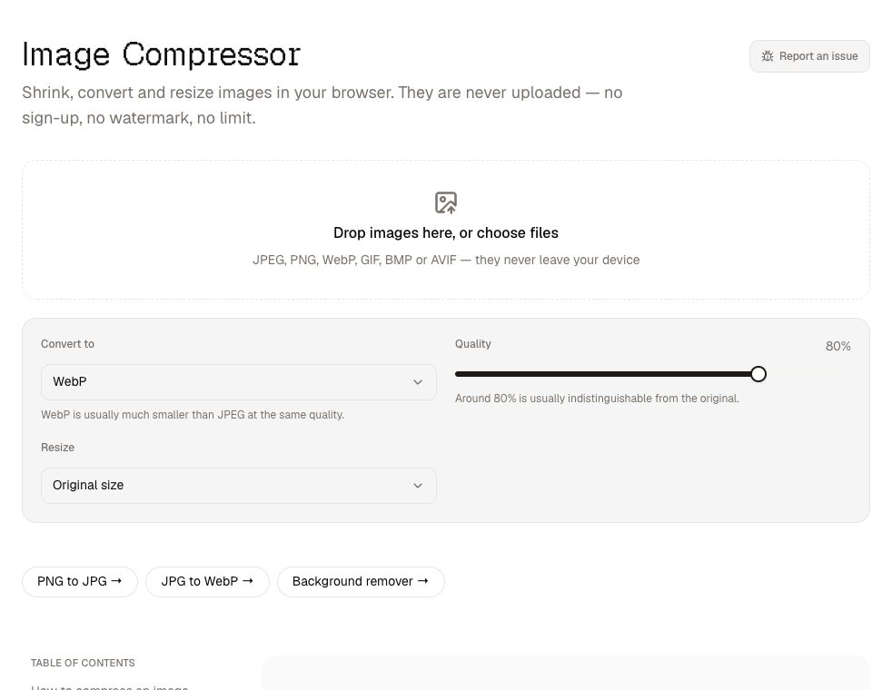

<div align="center">

<a href="https://zeal.tools">
  <picture>
    <source media="(prefers-color-scheme: dark)" srcset=".github/assets/logo-dark.svg">
    
  </picture>
</a>

# zeal.tools

**Free tools, made with zeal.**<br>
No sign-ups, no watermarks, no nonsense — and your files never leave your device.

[](https://zeal.tools)
[](https://github.com/zernonia/zeal-tools/actions/workflows/ci.yml)
[](LICENSE)
[](https://zeal.tools/.well-known/mcp/server-card.json)
[](#accessibility-and-performance)

[**Open the tools →**](https://zeal.tools) · [Blog](https://zeal.tools/blog) · [API](https://zeal.tools/api/v1) · [Request a tool](https://github.com/zernonia/zeal-tools/issues/new?template=tool-request.md)

<br>

<a href="https://zeal.tools">
  <picture>
    <source media="(prefers-color-scheme: dark)" srcset=".github/assets/home-dark.jpg">
    
  </picture>
</a>

</div>

<br>

The web is full of bad utility tools: QR generators stuffed with ads, outputs with watermarks, sign-up walls in
front of a ten-second job. zeal.tools is the alternative — fast, clean, open-source tools that do the job and get
out of the way. Almost all of them run entirely in your browser, including the AI ones.

## The tools

| | Tool | What it does | API · MCP |
|:-:|---|---|:-:|
| ▦ | [QR Code Generator](https://zeal.tools/tools/qr-code-generator) | Static QR codes for links, WiFi, vCards, email, phone and SMS — no expiry, PNG or SVG | ✓ |
| 🪄 | [Background Remover](https://zeal.tools/tools/background-remover) | Cut the subject out of a photo with an AI model that runs on your machine | |
| 🎚️ | [Stem Splitter](https://zeal.tools/tools/stem-splitter) | Split a song into vocals, drums, bass and the rest — or six stems — in the browser | |
| 🗜️ | [Image Compressor](https://zeal.tools/tools/image-compressor) | Compress, resize and convert images in a batch, without uploading them | |
| ⇄ | [Send to Device](https://zeal.tools/tools/send-to-device) | Phone to laptop and back, directly over your network — no cable, no cloud | |
| 🧾 | [Invoice Maker](https://zeal.tools/tools/invoice-maker) | Write an invoice, save it as a PDF, keep your details for next time | |
| 🔑 | [Password Generator](https://zeal.tools/tools/password-generator) | Strong passwords from your OS's cryptographic randomness, never sent anywhere | ✓ |
| 🙈 | [Image Redactor](https://zeal.tools/tools/image-redactor) | Brush over faces, plates or text to blur, pixelate or black them out | |
| 🔍 | [EXIF Viewer](https://zeal.tools/tools/exif-viewer) | See what a photo reveals — location included — and strip it losslessly | |
| 🎡 | [Name Picker](https://zeal.tools/tools/name-picker) | A fair spinning wheel for names, raffles and classrooms | ✓ |
| 🔖 | [Meta Tag Checker](https://zeal.tools/tools/meta-tag-checker) | Preview a link on Google, X, Facebook, LinkedIn and Slack, and fix the tags | ✓ |
| ⭐ | [Favicon Generator](https://zeal.tools/tools/favicon-generator) | Every icon a site or app needs, from one logo, in one zip | |
| ♫ | [Chord Transposer](https://zeal.tools/tools/chord-transposer) | Change the key of a chord chart without touching the lyrics, or find a capo | ✓ |
| 🥁 | [Metronome](https://zeal.tools/tools/metronome) | Tap tempo, accents and subdivisions, timed on the audio clock | |
| 🎸 | [Tuner](https://zeal.tools/tools/tuner) | Guitar, bass and ukulele tuner through your microphone | |
| ◷ | [Stage Timer](https://zeal.tools/tools/stage-timer) | A speaker countdown for the big screen, controlled from your laptop | |
| ⏳ | [Countdown Timer](https://zeal.tools/tools/countdown-timer) | Count down to any date — or the next Christmas, Easter or New Year | |
| ◈ | [Worship Pads](https://zeal.tools/tools/worship-pads) | Ambient pads in every key, synthesised live in the browser | |

<table>
  <tr>
    <td width="33%" valign="top">
      <a href="https://zeal.tools/tools/qr-code-generator"><picture><source media="(prefers-color-scheme: dark)" srcset="public/blog/tools/qr-code-generator-dark.jpg"></picture></a>
      <p align="center"><b>QR Code Generator</b></p>
    </td>
    <td width="33%" valign="top">
      <a href="https://zeal.tools/tools/name-picker"><picture><source media="(prefers-color-scheme: dark)" srcset="public/blog/tools/name-picker-dark.jpg"></picture></a>
      <p align="center"><b>Name Picker</b></p>
    </td>
    <td width="33%" valign="top">
      <a href="https://zeal.tools/tools/chord-transposer"><picture><source media="(prefers-color-scheme: dark)" srcset="public/blog/tools/chord-transposer-dark.jpg"></picture></a>
      <p align="center"><b>Chord Transposer</b></p>
    </td>
  </tr>
  <tr>
    <td width="33%" valign="top">
      <a href="https://zeal.tools/tools/stem-splitter"><picture><source media="(prefers-color-scheme: dark)" srcset="public/blog/tools/stem-splitter-dark.jpg"></picture></a>
      <p align="center"><b>Stem Splitter</b></p>
    </td>
    <td width="33%" valign="top">
      <a href="https://zeal.tools/tools/meta-tag-checker"><picture><source media="(prefers-color-scheme: dark)" srcset="public/blog/tools/meta-tag-checker-dark.jpg"></picture></a>
      <p align="center"><b>Meta Tag Checker</b></p>
    </td>
    <td width="33%" valign="top">
      <a href="https://zeal.tools/tools/image-compressor"><picture><source media="(prefers-color-scheme: dark)" srcset="public/blog/tools/image-compressor-dark.jpg"></picture></a>
      <p align="center"><b>Image Compressor</b></p>
    </td>
  </tr>
</table>

## The Zeal Promise

On every tool, non-negotiable:

- **No sign-up, ever.** There is no account system to sign up for.
- **No watermarks** on anything you download.
- **No ads near the download.** That area is never blocked or crowded.
- **Privacy-first.** Processing happens in your browser wherever it possibly can — even the background remover and
  stem splitter run their AI models on your own machine. The one tool that must touch a server, the meta tag checker,
  says so on the page.
- **Open source, MIT.** Audit it, contribute, or self-host it.

## Use it from code, too

The tools whose logic is a pure function — QR codes, passwords, chord charts, name picking and meta tags — are also
callable over REST and MCP, from the same implementation the UI uses.

**REST** — no key, no sign-up, 120 requests a minute:

```bash
curl -X POST https://zeal.tools/api/v1/qr \
  -H 'content-type: application/json' \
  -d '{"data": "https://zeal.tools"}'          # → SVG

curl 'https://zeal.tools/api/v1/qr?data=hello&format=png' -o qr.png
```

The full list lives at [`/api/v1`](https://zeal.tools/api/v1) and in the
[RFC 9727 catalog](https://zeal.tools/.well-known/api-catalog).

**MCP** — add it to Claude, your IDE or any MCP client:

```json
{ "mcpServers": { "zeal-tools": { "url": "https://zeal.tools/mcp" } } }
```

Agents can start from [`llms.txt`](https://zeal.tools/llms.txt).

## Built to be auditable

**Tool logic ships with zero runtime npm dependencies.** The app shell is Nuxt and Tailwind; everything a tool
actually computes is ours. The QR encoder is a from-scratch ISO/IEC 18004 implementation — segment encoding,
Reed–Solomon over GF(256), all eight masks with penalty scoring — and it is verified by round-tripping payloads
through an *independent* decoder held as a devDependency, across every version, error-correction level and mask.

There is exactly one exception, and it is [documented](CONTRIBUTING.md#runtime-dependency-allow-list):
`onnxruntime-web`, because executing a neural network is a whole ML runtime rather than a format we could own. It
loads lazily, only on the tools that need it, and the model weights stream from Hugging Face — nothing large ships in
a deploy.

Why bother?

1. **Readable in an afternoon.** A tool site handles WiFi passwords, contact details and photos. You should be able
   to read every line that touches them.
2. **Isomorphic by construction.** Pure functions run identically in your browser, in Cloudflare Workers and behind
   the MCP endpoint — one implementation, three surfaces.
3. **Proof, not vibes.** Self-written cores are tested against independent implementations and the spec, not just
   against themselves.

### Accessibility and performance

WCAG 2.2 AA in both themes: keyboard-complete, visible focus, 44px targets, live announcements and reduced motion.
The homepage and tool pages score **100** on Lighthouse accessibility, best practices and SEO. Every page is
prerendered and served from Cloudflare Workers, and each tool's code loads only on its own page.

## Architecture

One Nuxt 4 app, composed from **domain slices as Nuxt layers**. Everything that belongs to a tool lives in one
folder:

```
tools/qr-code-generator/
├── meta.ts          # registry entry: name, keywords, variants, api/mcp flags
├── core/            # ★ pure, isomorphic, zero-dependency logic + unit tests
├── app/             # pages, components, composables — this slice only
└── server/          # REST endpoint, importing the SAME core/
```

Adding a tool means adding a folder and one line in `shared/registry`; the homepage, search, sitemap, API index and
MCP tool list all follow from it. Slices never import from each other — shared code graduates to `shared/`. See
[CONTRIBUTING.md](CONTRIBUTING.md) for the slice template and the per-tool checklist.

## Development

```bash
pnpm install         # also runs nuxt prepare
pnpm dev             # dev server on :3000
pnpm test            # unit tests, including the encoder round-trips
pnpm lint            # eslint
pnpm build           # build for Cloudflare Workers
pnpm preview         # run the build in the real Workers runtime
```

Pushes to `main` deploy through Cloudflare Workers Builds; there are no credentials to set up.

## Contributing

Ideas and bug reports are welcome — every tool page has a **Report an issue** button that fills in which page you
were on. To suggest something new, [request a tool](https://github.com/zernonia/zeal-tools/issues/new?template=tool-request.md).
Pull requests should follow [CONTRIBUTING.md](CONTRIBUTING.md).

## License

[MIT](LICENSE) — built with zeal by [zernonia](https://github.com/zernonia).
